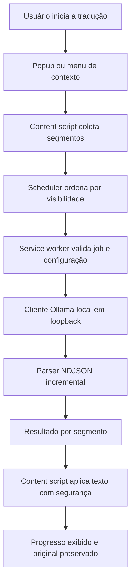

# Arquitetura — Lerium

Documento de limites de responsabilidade do Lerium. Resume e referencia a
proposta de [PLAN.md §4](PLAN.md); requisitos detalhados estão em
[PLAN.md §3](PLAN.md) e em [SCOPE.md](SCOPE.md). Decisões formais ficam em
[DECISIONS.md](DECISIONS.md).

## Visão geral

O usuário aciona a tradução pelo popup ou pelo menu de contexto. O content
script coleta os segmentos elegíveis da página e os entrega a uma fila
priorizada (conteúdo principal visível primeiro). O service worker valida o
job e a configuração e chama o Ollama local, cuja resposta em streaming é
lida por um parser NDJSON robusto. Cada segmento concluído volta ao content
script, que aplica o texto sem `innerHTML`, atualiza o progresso e mantém o
original para restauração imediata. Toda inferência ocorre na máquina do
usuário; não há backend próprio.

## Módulos e responsabilidades

| Módulo | Faz | Não pode fazer |
|---|---|---|
| `content` | Acessa o DOM, coleta e segmenta texto, aplica traduções, guarda e restaura o original, observa visibilidade/mutações, exibe overlay de progresso e mantém a máquina de estados por documento. | Chamar a API do Ollama diretamente; inserir saída do modelo via `innerHTML`; executar scripts ou instruções vindas da página. |
| `background` (service worker) | Roteia mensagens, valida jobs e configuração, chama o cliente Ollama, propaga cancelamentos (`AbortController`) e registra menus de contexto. | Usar variáveis globais como fonte de verdade de estado (o worker MV3 pode ser suspenso a qualquer momento); acessar o DOM das páginas; sobrescrever configurações em `onInstalled`. |
| `core` | Tipos/contratos, `PromptBuilder` versionado, `TranslationService`, adaptador `TranslationProvider` + `OllamaClient`, scheduler e parser NDJSON. | Depender de DOM ou de APIs do Chrome; manter estado de UI. Deve ser testável em isolamento. |
| `popup` / `options` | Apresentação, comandos do usuário e validação de entrada em PT-BR. | Conter lógica de tradução, prompt ou `fetch` próprios (todas as entradas usam o mesmo motor); precisar permanecer aberto para a tradução concluir. |
| `storage` | Preferências em `chrome.storage.local` com defaults e migrações não destrutivas; estado mínimo de sessão em `chrome.storage.session`. | Persistir conteúdo traduzido ou original das páginas por padrão; apagar preferências existentes em atualizações. |

## Contratos

Tipos compartilhados previstos (definidos em código a partir das Fases 2 e 3):

- `TranslationSettings` — preferências do usuário: endpoint local, modelo, idiomas, paralelismo, modo e domínios excluídos.
- `TranslationSegment` — unidade de texto coletada do DOM, com identidade estável no documento.
- `TranslationRequest` — pedido de tradução de um segmento dentro de um job, com idiomas e versão de prompt.
- `TranslationResult` — texto traduzido de um segmento, associado ao job e ao segmento de origem.
- `TranslationProgress` — contagem de segmentos concluídos, pendentes e com falha para a UI.
- `TranslationJob` — trabalho de tradução isolado por aba, documento e identificador do job.
- `TranslationError` — erro classificado (conexão, modelo ausente, HTTP, timeout, cancelamento, validação), transitório ou definitivo.
- `MessageRequest` — mensagem enviada entre popup, content script e service worker.
- `MessageResponse` — resposta tipada a uma `MessageRequest`, com sucesso ou `TranslationError`.

Tipos de compilação não bastam: toda mensagem recebida (e toda resposta do
Ollama) passa por validação em runtime antes de ser usada.

## Estados de tradução

Estados explícitos por documento (RF04, [PLAN.md §3](PLAN.md)):

- `idle` — nada em andamento; página no original.
- `loading` — preparando o job: verificando configuração e conexão, coletando segmentos.
- `translating` — segmentos sendo traduzidos e aplicados progressivamente.
- `translated` — todos os segmentos elegíveis concluídos; alternância com o original disponível.
- `cancelled` — usuário parou; novas requisições bloqueadas, as em andamento abortadas e original restaurado.
- `error` — falha que impede continuar; original preservado e opção de tentar novamente.

**Invalidação:** cada resultado carrega o identificador do job que o gerou.
Cancelamento, desligamento, recarga ou navegação (inclusive em SPA) encerram
o job atual; qualquer resultado que chegue depois com identificador antigo é
descartado e nunca aplicado ao DOM. Uma aba não interfere em outra.

## Limites de confiança e privacidade

- **Página é dado não confiável:** o texto coletado é apenas conteúdo a traduzir, nunca instrução para a extensão; o prompt separa instrução e texto com delimitação explícita.
- **Rede só no service worker:** popup, opções e content scripts não fazem `fetch`; enviam mensagens tipadas e validadas ao service worker, que aceita apenas remetentes da própria extensão (ADR-009).
- **Somente loopback:** o endpoint aceita apenas `http://localhost` ou `http://127.0.0.1` no MVP; endpoint remoto fica desabilitado.
- **DOM seguro:** traduções são inseridas via `textContent`/`nodeValue`; nenhuma URL ou HTML é criado a partir da resposta do modelo.
- **Sem logs de conteúdo:** logs registram só metadados (duração, quantidade de segmentos, códigos de erro).
- **Sem terceiros:** sem backend, telemetria, analytics ou upload de texto.
- **Menor privilégio:** sem `<all_urls>` indiscriminado; injeção sob demanda; cada permissão do manifesto justificada (ver [PLAN.md §8](PLAN.md)).

## Estrutura de diretórios

A árvore alvo é a proposta de [PLAN.md §4](PLAN.md) (`public/`,
`src/{background,content,core,popup,options,storage,shared}`,
`tests/{unit,integration,e2e,fixtures,mocks}`, `docs/`). Ela é uma
referência, não uma obrigação: pode ser adaptada se o build MV3 exigir,
mantendo a separação de responsabilidades acima.

A estrutura será criada **incrementalmente a partir da Fase 1**, apenas
quando houver código ou teste real para cada pasta. Não criar pastas vazias
para simular arquitetura.

## Decisões em aberto

Ainda não resolvidas; não tratar como definidas até haver ADR aceita em
[DECISIONS.md](DECISIONS.md) (ver também "Questões em aberto" em
[SCOPE.md](SCOPE.md)):

- **Injeção e permissões** — `activeTab` + `scripting` após ação do usuário vs. permissões opcionais por domínio para tradução automática persistente (ADR-002).
- **DOM com markup inline** — tradução por nó, por bloco com marcadores ou outra estratégia que não esvazie nós inline (ADR-003).
- **Identidade de documento/job e reidratação do service worker** — qual identificador comprovado usar (`documentId`, identificador de navegação ou equivalente) e como recuperar estado após suspensão do worker (ADR-004).
- **UX da tradução de seleção** — balão na página vs. resultado no popup, e comportamento quando o popup fecha (ADR-005).
- **CORS do Ollama** — validar se as requisições da extensão exigem configurar `OLLAMA_ORIGINS`; se exigirem, restringir à origem da extensão, nunca `*`.
