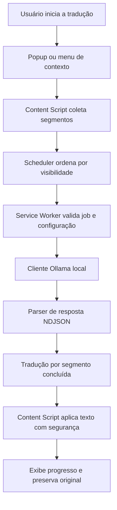

# Plano de desenvolvimento — Extensão de Tradução Literária Local

> **Documento de execução para agente de IA**  
> **Codinome provisório:** `local-novel-translator` (não considerar nome comercial definitivo)  
> **Data da análise:** 28/10/2026  
> **Status:** planejamento inicial; nenhuma implementação deste novo projeto foi feita  
> **Idioma de trabalho:** português brasileiro (código, identificadores e mensagens de commit podem seguir convenções técnicas em inglês)

---

## 0. Instruções obrigatórias ao agente de IA

Você é o agente de engenharia responsável por construir **uma extensão própria de Chrome**, independente do projeto usado como referência. Execute as etapas incrementalmente, sempre deixando o repositório em estado funcional.

**Objetivo do produto:** traduzir páginas e trechos de texto diretamente no navegador por meio de modelos de IA executados no Ollama local, priorizando **naturalidade literária, preservação do HTML, privacidade, rapidez percebida e ausência de cobranças/quotas de serviços externos**.

### Regras de execução

1. Antes de escrever código, inspecione o repositório atual, os arquivos existentes e o histórico recente; não presuma que está vazio.
2. Leia este plano integralmente e use os critérios de aceite de cada etapa como definição de pronto.
3. **Não copie o código-fonte da extensão de referência.** Use suas funcionalidades e comportamentos como especificação; faça implementação independente. Confirme a licença antes de considerar qualquer reutilização de trechos ou ativos.
4. Implemente **uma tarefa coesa de cada vez**; evite introduzir funcionalidades de fases futuras sem necessidade.
5. Antes de cada tarefa, registre em poucas linhas: intenção, arquivos previstos, riscos e critério de validação.
6. Ao concluir uma tarefa, execute verificações relevantes, documente o resultado e faça **um commit pequeno e atômico**. Não faça commit com lint, typecheck ou testes falhando sem explicar e registrar o bloqueio.
7. Não modifique funcionalidades estáveis sem justificativa, cobertura de testes e plano de regressão.
8. Não faça `push`, merge, release, publicação na Chrome Web Store ou alterações destrutivas em repositório remoto sem autorização explícita do responsável.
9. Mantenha o arquivo `docs/PROGRESS.md` atualizado, incluindo fase, tarefa, commits locais, testes executados e próximos passos.
10. Ao encontrar bloqueio técnico, tente diagnosticá-lo com evidências; não substitua silenciosamente o requisito por uma solução inferior.
11. Prefira estruturas simples, funções puras e interfaces explícitas; **não superarquitetar** uma extensão de navegador.
12. Use somente dependências gratuitas e justificadas; não introduza back-end, nuvem paga ou chave de API comercial no MVP.
13. Não colete, envie, registre em logs ou armazene permanentemente texto privado dos sites por padrão.
14. Ao final de cada fase, apresente: resumo, decisões técnicas, commits, critérios atendidos, pendências e sugestão da próxima branch.

---

## 1. Contexto de uso e restrições do usuário

### Ambiente validado

- Sistema principal: **Windows 11**.
- Navegador: **Google Chrome**, desktop.
- Equipamento-alvo: **Intel Core i5-13420H, 32 GB de RAM, vídeo integrado**.
- Runtime de IA: **Ollama**, servidor local em `http://localhost:11434`.
- Modelo já instalado e testado: **`translategemma:4b`** (4,3B parâmetros, GGUF Q4_K_M).
- API `/api/tags` respondeu corretamente; o usuário já traduziu uma página inteira com a extensão de referência modificada.
- Experiência observada: tradução substitui o texto original, é aplicada progressivamente e a espera percebida durante a leitura foi baixa. **Esse relato é uma observação do usuário, não um benchmark reproduzível nem garantia de menos de 3 s para páginas inteiras.**

### Requisitos de produto

- **P0 (obrigatório):** totalmente local e gratuito; nenhuma quota de fornecedor; consumo de CPU/RAM e tempo de execução continuam existindo.
- **P0:** idioma de destino padrão `pt-BR`; fonte primária `en`, com expansão posterior.
- **P0:** servir não apenas a *Infinite Mage*, mas a qualquer novel e a páginas com texto compatível.
- **P0:** preservar o estilo da obra (fantasia, romance, ficção científica, mistério etc.) sem prompt vinculado a personagens específicos.
- **P0:** experiência de leitura em que o texto original seja substituído pela tradução; permitir restaurar o original.
- **P0:** tradução manual de página, tradução de seleção e cancelar/retomar; indicação de progresso e erros úteis.
- **P0:** configurações simples e mensagens inteiramente em PT-BR.
- **P1:** glossários por obra, quando houver evidência de inconsistência (não antecipar no MVP).
- **P1:** perfis de prompt, cache opcional e controles de desempenho.

### Fora de escopo no MVP

- Publicação na Chrome Web Store; sincronização em nuvem; contas; backend; pagamento; OCR/imagens/manhwa; tradução automática em massa de acervos; scraping de sites; desbloqueio de conteúdo pago; leitura TTS; suporte completo a Firefox/Safari; treinamento de modelo; indexação de obras protegidas.

---

## 2. Engenharia reversa funcional da extensão de referência

### Fonte e limites da análise

**Repositório observado:** https://github.com/shikira/ollama-translator  
**Arquivos examinados:** `README.md`, `manifest.json`, `background.js`, `content.js`, `popup.js`, `options.js` (branch pública `main` em 28/10/2026). O usuário também havia alterado localmente sua própria cópia para suportar PT-BR e usar `translategemma:4b`.

Esta é uma análise **estática de código público** complementada pelo teste relatado pelo usuário, não uma auditoria completa de todos os websites. A documentação da referência menciona licença MIT, mas na consulta ao repositório **não foi localizado um arquivo `LICENSE` na raiz nem metadado de licença reconhecido pelo GitHub**. Antes de reutilizar código, ícones ou marca, verificar a autorização/licença. O novo projeto deve manter identidade e implementação próprias.

### 2.1 Matriz de capacidades observadas

| ID | Capacidade na referência | Evidência técnica | Diretriz para o novo produto |
|---|---|---|---|
| F01 | Liga/desliga tradução por aba | Toggle em `popup.js`; estado em `background.js`/`content.js` | **P0 — reproduzir**, com estado consistente |
| F02 | Tradução da página inteira | `content.js`: coleta e agrupa nós de texto | **P0 — reproduzir** com DOM preservado |
| F03 | Tradução de seleção | Popup em `popup.js`, menu em `background.js` | **P0 — implementar o fluxo completo** |
| F04 | Menu de contexto | Opções de página e seleção | **P0** |
| F05 | Alternar original/tradução | `WeakMap` e botão flutuante | **P0**, sem perder texto original |
| F06 | Prioridade ao conteúdo visível | Filas: principal visível → principal fora da tela → navegação | **P0**, com melhorias de reavaliação |
| F07 | Paralelismo | Máximo 5 requisições em uma rotina | **P0**, limite configurável e compartilhado |
| F08 | Progresso visual | Notificação flutuante | **P0**, não intrusiva e acessível |
| F09 | Processamento ao rolar | Evento `scroll` com debounce | **P0**, preferir `IntersectionObserver` quando aplicável |
| F10 | Suporte parcial a SPA | `MutationObserver` + comparação de URL | **P1**, robustecer conteúdo dinâmico |
| F11 | Ignorar blocos de código | Filtros de tags e classes comuns | **P0**, filtros sem falsos positivos excessivos |
| F12 | Configuração de endpoint/modelo/idioma | `options.html`/`options.js` | **P0**, com validação |
| F13 | Domínios excluídos | Configuração `excludeDomains` | **P0**, garantir aplicação real |
| F14 | API Ollama local com streaming | `background.js`: `/api/chat` | **P0**, parser NDJSON robusto |
| F15 | Tradução de qualidade literária | Prompt genérico na referência; customizado na cópia do usuário | **P0**, prompt universal e testável |
| F16 | Persistência de configurações | `chrome.storage.sync` | **P0**, defaults sem sobrescrita |
| F17 | Alteração progressiva da página | Atualização de nós após cada tradução | **P0**, sem desalinhamento de markup |

### 2.2 Problemas e riscos encontrados — **não reproduzir**

1. **Permissões amplas:** a referência declara `<all_urls>` em `host_permissions` e `content_scripts.matches`; avaliar menor privilégio (`activeTab`, injeção sob demanda, permissões opcionais para sites persistentes).
2. **Duplicação de tradução:** seleção do popup possui `fetch` e prompt próprios, enquanto a página usa a função do background; centralizar tudo em um único cliente/adaptador.
3. **Streaming frágil:** divide cada chunk diretamente por `\n`; um objeto JSON pode chegar entre dois chunks e ser descartado. Exigir buffer incremental, suporte a `\r\n` e validação de `done`/erros.
4. **Configuração contraditória:** README informa que `autoTranslate` foi substituído pelo toggle, mas `translatePage()` ainda interrompe a tradução se essa opção estiver falsa. Separar `manualTranslate`, `autoTranslateOnNavigation` e preferências persistentes.
5. **Linguagem detectada parcialmente:** `background.js` trata basicamente japonês/inglês; código de página usa heurísticas distintas, insuficientes para múltiplos idiomas e destino `pt-BR`. Padronizar estratégia e permitir fonte explícita.
6. **Risco de perda de formatação:** alguns parágrafos com múltiplos nós têm toda a tradução inserida no primeiro nó e os seguintes são esvaziados. Isso pode inutilizar `<strong>`, `<em>` ou links internos. Testar e definir abordagem que preserve marcação.
7. **Estado efêmero no service worker:** `Set` global perde o estado após suspensão do worker MV3. Usar `chrome.storage.session` quando pertinente; manter máquina de estados no content script.
8. **Cancelamento incompleto:** flag local impede aplicação de alguns resultados, mas requisições em andamento podem prosseguir. Usar `AbortController` e IDs de jobs; não permitir que resposta antiga sobrescreva conteúdo novo.
9. **Concorrência inconsistente:** rotina de scroll dispara `Promise.all` sem usar necessariamente o mesmo limite da fila principal. Centralizar scheduler e limite.
10. **Acionamento por seleção:** o background envia `translateSelection` ao content script, mas a análise do listener público em `content.js` não mostrou esse caso; adicionar teste integrado para garantir que o menu realmente funciona.
11. **Possível conflito em SPA:** mudanças no DOM, navegação e scroll podem criar traduções repetidas, listeners duplicados e referências antigas. Tratar descarte/limpeza por navegação.
12. **Logs excessivos:** referência registra trechos do original no console; por privacidade, desabilitar logs de conteúdo e definir observabilidade por metadados.
13. **Inicialização destrutiva:** `storage.sync.set` em `onInstalled` sem verificar dados existentes pode redefinir configurações após atualização. Aplicar migrações de configuração não destrutivas.
14. **CORS e endpoints:** documentação da referência recomenda `OLLAMA_ORIGINS=chrome-extension://*`; no produto novo, usar permissões do Chrome e testar as origens de maneira restrita. Não habilitar CORS amplo automaticamente.

---

## 3. Escopo funcional e critérios de aceite do MVP

### RF01 — Inicialização e configurações

- Página de opções em PT-BR: endereço local, modelo, origem/destino, paralelo máximo, modo de tradução e domínios excluídos.
- `localhost:11434` e `translategemma:4b` como defaults; detectar modelos instalados via `/api/tags` quando possível.
- Endpoint remoto **desabilitado no MVP**; a entrada padrão só aceita `http://localhost` ou `http://127.0.0.1` e porta explícita/implícita permitida.
- Valores persistidos e migrados sem apagar preferências preexistentes.
- Checagem clara de conexão, modelo inexistente e API indisponível.

**Aceite:** salvar, recarregar extensão e manter as configurações; erros exibidos em português; nenhuma configuração sobrescrita indevidamente.

### RF02 — Traduzir texto selecionado

- Acionar pelo popup e menu de contexto.
- Mostrar indicador de carregamento e tradução sem perder seleção.
- Reutilizar `TranslationService` e o mesmo prompt/idioma da página.
- O popup não deve precisar permanecer aberto para que a tradução seja concluída se a experiência escolhida for um balão na página; definir comportamento explícito.

**Aceite:** seleção no conteúdo principal e em elementos inline; resultado correto em PT-BR; tratamento de seleção vazia e Chrome pages não suportadas.

### RF03 — Traduzir página inteira

- Coletar somente nós/contêineres elegíveis.
- Excluir `script`, `style`, `noscript`, `code`, `pre`, campos editáveis, inputs, textareas, conteúdo de extensão e elementos ocultos sensíveis.
- Priorizar artigo/conteúdo principal visível, depois conteúdo principal fora da tela, depois navegação.
- Atualizar a página por unidade concluída, preservando posições, quebras, estilos e links.
- Reter original para retorno imediato.

**Aceite:** textos em `<p>`, `<em>`, `<strong>` e `<a>` continuam navegáveis/estilizados; sem duplicação ou remoção de nós; percentuais de progresso coerentes.

### RF04 — Estado, controles e cancelamento

- Ações: `iniciar`, `pausar/cancelar`, `mostrar original`, `mostrar tradução`, `tentar novamente`.
- Estados explícitos: `idle`, `loading`, `translating`, `translated`, `cancelled`, `error`.
- Isolar cada trabalho por `tabId + documentId/navigationId + jobId` (ou identificador equivalente comprovado).
- Cancelamentos e navegações tornam resultados antigos inválidos.
- Ao desligar, parar novas solicitações, abortar as possíveis e restaurar o texto original.

**Aceite:** desligar no meio de dez parágrafos não injeta texto depois; reativar não gera duplicação; nenhuma aba interfere na outra.

### RF05 — Tradução literária universal

- Prompt padrão **independente de obra**: naturalidade, fidelidade, voz do narrador, ritmo, diálogos, precisão técnica, sem invenção/omissão.
- Detectar ou permitir selecionar idioma de origem; fonte padrão inglês, destino PT-BR.
- Um `PromptBuilder` versionado e testado; separar instrução do texto original com delimitação explícita.
- Não prometer preservação perfeita em todos os modelos; apresentar opções de qualidade/performance.

**Aceite:** mesma engine para romance, fantasia e sci-fi; saída exclusivamente traduzida; fixtures com nomes próprios, diálogo e termos recorrentes.

### RF06 — API e processamento

- Cliente único da API local Ollama.
- `GET /api/tags` e `POST /api/chat` com payload validado.
- Suporte a `stream: true` via NDJSON incremental, com buffer de linhas incompletas; `stream: false` somente como fallback diagnóstico.
- Scheduler com limite configurável de **1 a 5** requisições (default inicial **2**; medir no equipamento real antes de aumentar).
- Retry limitado e com backoff apenas para falhas transitórias; não repetir erros definitivos de modelo/configuração indefinidamente.

**Aceite:** nenhum token perdido em stream fragmentado artificialmente; falha preserva original; timeout/cancelamento controlados; sem requisições infinitas.

### RF07 — Privacidade e segurança

- Sem backend próprio, telemetria, analytics, upload de textos ou armazenamento persistente de conteúdo por padrão.
- Validar e limitar endpoint; restringir permissões do manifesto; usar `chrome.scripting` com acesso sob demanda.
- Não executar scripts extraídos das páginas; texto de página é dado não confiável, não instrução para a extensão.
- Inserir traduções via `textContent`/`nodeValue`, **não** `innerHTML` de resposta do modelo.
- Segurança adicional contra inserção de comandos no prompt e acesso indevido a URLs internas.

**Aceite:** auditoria manual de permissões; nenhuma requisição para domínio de terceiros fora de páginas acessadas pelo usuário; páginas `chrome://` e Chrome Web Store tratadas como não suportadas.

---

## 4. Arquitetura proposta (enxuta, modular e testável)

### Stack

| Camada | Escolha | Justificativa |
|---|---|---|
| Plataforma | Chrome Extension Manifest V3 | Compatibilidade e modelo atual de extensões |
| Linguagem | TypeScript, modo `strict` | Segurança de tipos e contratos explícitos |
| Build | Vite + configuração para bundle MV3 | Build leve; validar paths no manifest e SW |
| UI | HTML/CSS + TypeScript (sem framework no MVP) | Menos dependências; popup/opções pequenos |
| Testes unitários | Vitest | Testes rápidos de regras puras |
| Testes DOM | Vitest + ambiente DOM de testes | Segmentação, substituição e restauração |
| Testes end-to-end | Playwright + Chromium | Extensão real + páginas fixture |
| Qualidade | ESLint + Prettier + `tsc --noEmit` | Padronização e prevenção de regressão |
| IA | Ollama local via `/api/chat` | Gratuito, local, modelo intercambiável |
| Persistência | `chrome.storage.local` + `chrome.storage.session` | Preferências e estado de sessão independentes |
| CI | GitHub Actions | Lint, build, typecheck, unit e testes determinísticos |

### Estrutura de diretórios sugerida

```text
local-novel-translator/
├── public/
│   ├── manifest.json
│   └── icons/
├── src/
│   ├── background/
│   │   ├── index.ts
│   │   ├── message-router.ts
│   │   └── job-manager.ts
│   ├── content/
│   │   ├── index.ts
│   │   ├── dom-collector.ts
│   │   ├── segmenter.ts
│   │   ├── dom-translator.ts
│   │   ├── translation-state.ts
│   │   ├── viewport-priority.ts
│   │   └── overlay.ts
│   ├── popup/
│   │   ├── index.html
│   │   ├── index.ts
│   │   └── style.css
│   ├── options/
│   │   ├── index.html
│   │   ├── index.ts
│   │   └── style.css
│   ├── core/
│   │   ├── types.ts
│   │   ├── constants.ts
│   │   ├── prompt-builder.ts
│   │   ├── translation-service.ts
│   │   ├── scheduler.ts
│   │   ├── ndjson-parser.ts
│   │   └── ollama-client.ts
│   ├── storage/
│   │   ├── settings-repository.ts
│   │   └── session-repository.ts
│   └── shared/
│       ├── messages.ts
│       ├── errors.ts
│       └── validation.ts
├── tests/
│   ├── unit/
│   ├── integration/
│   ├── e2e/
│   ├── fixtures/
│   └── mocks/
├── docs/
│   ├── ARCHITECTURE.md
│   ├── DECISIONS.md
│   ├── PROGRESS.md
│   └── TEST_PLAN.md
├── .github/
│   ├── workflows/ci.yml
│   └── PULL_REQUEST_TEMPLATE.md
├── AGENTS.md
├── CONTRIBUTING.md
├── README.md
├── package.json
├── tsconfig.json
├── eslint.config.js
└── vite.config.ts
```

A estrutura é uma **proposta**, não uma obrigação cega: se o build MV3 exigir distribuição diferente, adaptar mantendo a separação de responsabilidades. Evitar pastas vazias só para simular arquitetura.

### Fluxo principal



**Separação de responsabilidades:**

- `content`: acesso ao DOM, preservação/restauração, observadores, overlay e controle da fila por documento.
- `background`: acesso à API, roteamento de mensagens e cancelamentos, com cuidados ao ciclo de vida do service worker.
- `core`: modelos, prompt, parser e scheduler; sem dependência desnecessária do Chrome ou DOM.
- `popup/options`: somente apresentação, comando e validação de entrada.
- `storage`: configuração e estado; sem persistir novels traduzidas por padrão.

**Contrato tipado sugerido:** `TranslationSettings`, `TranslationSegment`, `TranslationRequest`, `TranslationResult`, `TranslationProgress`, `TranslationJob`, `TranslationError`, `MessageRequest`, `MessageResponse`. Definir esquema de validação para mensagens recebidas; não confiar exclusivamente em tipos de compilação.

### Decisões a validar antes de codificar

- Política de injeção: preferir `activeTab + scripting` após ação do usuário; se persistência automática por site for necessária, pedir permissões opcionais especificamente para aquele domínio.
- Estratégia de DOM: segmentar em blocos sem destruir estrutura inline. Para casos complexos, tradução por nó ou estratégia de marcadores testada; **nunca esvaziar silenciosamente nós inline**.
- Estratégia de execução: testar ciclo de vida de MV3, reinício de worker, requisições longas e reidratação de estado. Não confiar em variáveis globais do worker como fonte de verdade.
- Estratégia de modelos: adaptador `TranslationProvider` deve permitir futura troca do Ollama, mas **implementar somente Ollama no MVP**.

---

## 5. Git: branches, commits, PRs e versionamento — **regras obrigatórias**

### 5.1 Fluxo de branches

Usar **GitHub Flow / trunk-based simplificado** para projeto individual assistido por IA:

- `main`: branch principal, sempre compilável e estável.
- Branches **curtas e de vida breve**, criadas a partir da `main` atualizada para **uma única tarefa/feature pequena**.
- **Não criar `develop` nem branches de fase com vida longa.** Um épico contém várias branches pequenas.
- Convenções de nome, em minúsculas, sem espaços/acentos:

```text
feat/extension-skeleton
feat/ollama-connection
feat/page-translation
feat/translation-toggle
fix/ndjson-boundaries
fix/inline-formatting
test/dom-restoration
refactor/translation-service
docs/architecture
chore/ci-pipeline
```

- Antes de iniciar: `git status` limpo, atualizar `main`, criar branch a partir de `main` e confirmar branch ativa.
- Para cada PR: escopo único, descrição de comportamento, checklist de teste e prints quando houver UI.
- Preferir PRs pequenos e revisáveis; **meta indicativa**, não regra rígida: até ~300 linhas líquidas e duração de até 1–2 dias de trabalho. Dividir por comportamento sempre que possível.
- Merge apenas após revisão e CI aprovado; estratégia de merge a definir no repositório. Se preservar commits atômicos for importante, não fazer squash indiscriminado.
- Após merge, eliminar branch local/remota já concluída quando autorizado.
- Não fazer commit direto em `main`, exceto manutenção excepcional expressamente aprovada.

### 5.2 Conventional Commits 1.0.0

Formato obrigatório:

```text
<type>(<scope>): <descrição curta no imperativo>

[corpo opcional explicando motivo]

[rodapé opcional]
```

**Tipos permitidos:** `feat`, `fix`, `refactor`, `perf`, `test`, `docs`, `style`, `build`, `ci`, `chore`, `revert`.

**Escopos sugeridos:** `extension`, `manifest`, `content`, `popup`, `options`, `ollama`, `stream`, `queue`, `dom`, `prompt`, `storage`, `security`, `ci`, `docs`.

**Padrões internos:**

- Assunto em minúsculas após `:`, objetivo, de preferência **até 72 caracteres** no total.
- Um commit = **uma mudança lógica e verificável**. Não juntar UI, parser, CI e refatoração em uma única mudança.
- Explicar **o motivo** no corpo quando a alteração não for óbvia.
- Usar `!` ou rodapé `BREAKING CHANGE:` para mudança incompatível.
- Referenciar issue/PR quando houver: `Refs: #12`, `Closes: #12`.
- Não usar mensagens vagas: `update`, `fix stuff`, `wip`, `changes`, `ajustes`.
- Não adicionar binários de modelo, tokens, chaves, dados pessoais, páginas de novels ou `node_modules/` ao Git.
- Executar `git diff --check` e revisar o diff antes de commitar.

**Exemplos bons e pequenos:**

```text
chore(extension): configura projeto TypeScript e Vite
test(stream): cobre JSON dividido entre chunks
feat(ollama): adiciona consulta aos modelos instalados
feat(content): coleta blocos de texto elegíveis
feat(queue): prioriza parágrafos visíveis
fix(dom): preserva formatação inline após tradução
feat(popup): implementa alternância de tradução
refactor(prompt): centraliza instruções literárias
docs(architecture): documenta fluxo MV3
ci: executa lint, typecheck e testes no pull request
```

**Exemplo de sequência atômica:** uma branch `feat/ollama-connection` pode conter `test(ollama): cobre erros de conexão`, depois `feat(ollama): implementa cliente local` e `feat(options): exibe modelos disponíveis`, **somente se o PR continuar coeso**. Em caso contrário, separar branches.

### 5.3 Pull requests, revisão e CI

Checklist obrigatório em todo PR:

```markdown
## Objetivo
<!-- Que problema esta branch resolve? -->

## Mudanças
<!-- O que mudou, sem listar arquivos irrelevantes -->

## Testes
- [ ] npm run lint
- [ ] npm run typecheck
- [ ] npm run test
- [ ] npm run build
- [ ] Smoke test manual (se houver integração Chrome/Ollama)

## Riscos e regressões
<!-- Privacidade, DOM, desempenho, compatibilidade -->

## Evidência
<!-- Prints, logs sem texto privado, testes e links -->
```

**Merge bloqueado** caso lint, typecheck, build, testes obrigatórios, revisão de permissões ou critérios de aceite não estejam atendidos. Se algum comando ainda não existir nas primeiras tarefas, registrar explicitamente e implementá-lo na fase de fundação.

### 5.4 Versões

- `0.1.0`: esqueleto funcional + conexão ao Ollama.
- `0.2.0`: MVP de página/seleção + controles estáveis.
- `0.3.0`: endurecimento de DOM/SPA, erros e acessibilidade.
- `1.0.0`: primeira versão estável após aceite completo e revisão de segurança.
- Seguir SemVer para versões do projeto; manter `manifest.version` válido conforme regras do Chrome e registrar mudanças em `CHANGELOG.md` quando iniciar releases.

### 5.5 Política de `.gitignore` — obrigatória desde a fundação

Criar o `.gitignore` **antes do primeiro commit que adicione dependências, builds ou arquivos de ambiente**. Manter o arquivo na raiz do repositório e revisá-lo sempre que o projeto receber ferramentas que gerem novos artefatos. Não copiar indiscriminadamente um template que ignore arquivos essenciais ao projeto.

**Conteúdo inicial sugerido para TypeScript + Vite + Chrome Manifest V3 + Vitest/Playwright:**

```gitignore
# Dependências instaladas (não ignorar package-lock.json)
node_modules/

# Saídas geradas de build/empacotamento
dist/
build/

# Cobertura e relatórios gerados por testes
coverage/
playwright-report/
test-results/

# Variáveis de ambiente locais e segredos
.env
.env.*
!.env.example
*.pem
*.p12
*.pfx

# Cache e artefatos incrementais
.cache/
.vite/
*.tsbuildinfo

# Logs e arquivos temporários
*.log
npm-debug.log*
*.tmp
*.bak

# Arquivos do sistema operacional
.DS_Store
Thumbs.db
```

**Regras de validação e manutenção:**

1. **Versionar obrigatoriamente:** `package.json`, `package-lock.json` (quando usar npm), `manifest.json`, `src/`, testes e fixtures sintéticas, `vite.config.*`, `tsconfig*.json`, configs de ESLint/Prettier/Vitest/Playwright, `.github/workflows/`, documentação, ícones originais e `.env.example` **sem valores secretos**.
2. Não versionar `node_modules/`, bundles compilados do Chrome, relatórios de cobertura, caches, logs, arquivos `.env` reais, chaves privadas, credenciais ou dados privados de leitura. Não adicionar padrões genéricos como `src/`, `*.json`, `*.ts`, `*.html`, `*.md` ou `tests/`.
3. Não depender apenas do `.gitignore` para proteger segredos: antes de cada commit, revisar o diff, conferir `git status` e usar verificação de segredos no CI quando viável. Arquivos previamente rastreados **continuam versionados** mesmo depois de incluídos no `.gitignore`; corrigir o índice de forma consciente e sem apagar arquivos locais, após revisão.
4. Validar o comportamento com `git status --short --ignored` e, para casos específicos, `git check-ignore -v <caminho>`; verificar `git ls-files` para identificar arquivos gerados ou sigilosos já rastreados. Não assumir que o padrão está correto só porque foi escrito.
5. Revisar os padrões ao adicionar nova dependência, gerador, ferramenta de testes ou formato de distribuição. Documentar exceções deliberadas. Não ignorar o arquivo de lock nem resultados de testes escritos como código/fixtures estáveis.
6. Configurações locais de IDE podem ser ignoradas caso contenham caminhos pessoais, mas configurações compartilhadas úteis devem ser versionadas de modo explícito; decidir por arquivo, não por exclusão indiscriminada da pasta.

**Critério de aceite:** uma instalação `npm ci` e um build/teste criam arquivos ignorados, enquanto o código-fonte, lockfile, manifesto, configurações e testes continuam visíveis ao Git. Nenhuma credencial ou conteúdo privado aparece nos arquivos preparados para commit.

---

## 6. Roadmap incremental — executar em ordem, sem pular gates

### Fase 0 — Descoberta e especificação (P0)

**Objetivo:** congelar o escopo do MVP antes de gerar arquivos.

**Tarefas**

- [ ] Confirmar que o repositório novo é independente; registrar referência e limitações da engenharia reversa.
- [ ] Validar licença do projeto observado ou documentar decisão de implementar somente o comportamento.
- [ ] Criar `docs/ARCHITECTURE.md` com limites de responsabilidade.
- [ ] Criar `docs/DECISIONS.md` com primeira ADR: Manifest V3 + TypeScript + Ollama local.
- [ ] Criar `docs/TEST_PLAN.md` com cenário de novel e fixture de HTML própria.
- [ ] Criar `docs/PROGRESS.md` e `AGENTS.md` resumindo estas regras.

**Branches sugeridas:** `docs/product-scope`, `docs/architecture`.

**Commits exemplares:** `docs(scope): define requisitos do MVP`; `docs(architecture): registra decisões iniciais`.

**Gate:** requisitos P0 documentados, critérios de aceite claros, nenhuma dependência legal ou técnica ambígua tratada como resolvida.

### Fase 1 — Fundação e ferramentas (P0)

- [ ] Inicializar TypeScript strict, Vite, `package.json`, scripts e estrutura mínima MV3.
- [ ] Criar manifesto com permissões mínimas justificadas; ícones originais.
- [ ] Configurar Vitest, ESLint, Prettier, typecheck e build.
- [ ] Criar popup simples em PT-BR e página de configurações vazia, mas navegável.
- [ ] Criar `.gitignore` **antes do primeiro commit de dependências/build**, aplicando integralmente a política da seção 5.5 e conferindo os arquivos efetivamente rastreados.
- [ ] Validar `git status --short --ignored`, `git check-ignore -v` para arquivos gerados e conferir `package-lock.json`/`manifest.json`/testes como versionáveis.
- [ ] Criar pipeline CI com lint, typecheck, testes e build.
- [ ] Documentar instalação **Load unpacked** do build no Chrome.

**Branches:** `chore/project-bootstrap`, `ci/quality-gates`, `feat/popup-shell`.

**Gate:** extensão carrega sem erros; `npm run lint`, `npm run typecheck`, `npm run test`, `npm run build` executam; CI equivalente passa; `.gitignore` validado contra arquivos reais sem ocultar o lockfile, o manifesto ou os testes, e sem versionar artefatos/segredos.

### Fase 2 — Configurações e conexão local (P0)

- [ ] Implementar `TranslationSettings` e repositório de configurações.
- [ ] Defaults PT-BR, origem EN, `translategemma:4b`, endpoint local.
- [ ] Implementar `GET /api/tags`, timeout, validação do endpoint e seleção de modelo.
- [ ] Evitar apagar preferências em `onInstalled`/atualizações.
- [ ] Implementar diagnósticos: Ollama indisponível, porta incorreta, modelo ausente.
- [ ] Definir comportamento de configurações por usuário e por aba.

**Branches:** `feat/settings-storage`, `feat/ollama-discovery`, `fix/default-migration`.

**Gate:** conectar no Ollama do usuário; modelo listado; desconectar Ollama produz erro controlado; persistência funciona ao recarregar.

### Fase 3 — Motor de tradução e streaming (P0)

- [ ] Implementar `TranslationProvider` e `OllamaClient` sem acesso ao DOM.
- [ ] Centralizar `PromptBuilder` universal e versão de prompt.
- [ ] Implementar parser NDJSON robusto (UTF-8, multichunk, múltiplas linhas/chunk, CRLF, linha final, erros).
- [ ] Validar `done`, respostas vazias, falhas HTTP, mensagens Ollama de erro e cancelamento.
- [ ] Adicionar `AbortController`, limite de timeout adequado e retry conservador.
- [ ] Testar fixtures: narrativa, diálogo, termo técnico, nome próprio, parágrafo longo e instruções maliciosas presentes na página.

**Branches:** `feat/ollama-chat`, `fix/ndjson-parser`, `feat/literary-prompt`, `test/translation-service`.

**Gate:** contrato `translate(text, options)` produz texto válido; nenhum conteúdo é perdido por chunk arbitrário; todos os fluxos usam o mesmo cliente.

### Fase 4 — DOM e tradução de página (P0)

- [ ] Criar coleta com `TreeWalker` e regras de exclusão.
- [ ] Definir segmentação por bloco (parágrafo, subtítulo, lista), preservando espaços e quebras.
- [ ] Criar sistema de identidade de segmento estável por documento.
- [ ] Implementar aplicação segura da tradução e restauração do original.
- [ ] Cobrir markup inline, links, comentários, textos invisíveis, formulário e nós destruídos pelo site.
- [ ] Implementar início manual via popup/injeção sob demanda.

**Branches:** `feat/dom-collection`, `feat/dom-segmentation`, `feat/page-translation`, `test/inline-markup`.

**Gate:** fixture HTML própria traduzida sem quebrar estrutura; `original -> traduzido -> original` retorna o conteúdo exato, incluindo links e formatação.

### Fase 5 — Experiência progressiva e desempenho (P0)

- [ ] Implementar fila compartilhada com prioridades: visível principal / principal não visível / periférico.
- [ ] Controlar requisições paralelas globalmente por aba, sem burst no scroll.
- [ ] Implementar observação de visibilidade; priorizar conteúdo que entrou na tela.
- [ ] Implementar UI de progresso acessível e não intrusiva.
- [ ] Medir tempo para primeira tradução visível, conclusão e uso de memória no hardware real.
- [ ] Evitar reler/retraduzir segmentos inalterados na mesma sessão.

**Branches:** `feat/translation-scheduler`, `feat/viewport-priority`, `feat/progress-overlay`, `perf/scroll-translation`.

**Gate:** texto visível recebe prioridade demonstrável; limite de concorrência respeitado inclusive no scroll; sem travamento perceptível no site fixture.

### Fase 6 — Seleção, contexto e controles (P0)

- [ ] Tradução de seleção a partir do popup.
- [ ] Menus de contexto: seleção e página inteira.
- [ ] Toggle de tradução/original; parar; retomar; nova tentativa quando houver erro.
- [ ] Exibir estado real (não apenas ícone visual) e feedback claro de ações.
- [ ] Verificar compatibilidade das ações quando popup fecha.

**Branches:** `feat/selection-translation`, `feat/context-menus`, `feat/translation-toggle`.

**Gate:** todas as entradas levam ao mesmo motor; desativar interrompe alterações tardias; texto original sempre recuperável.

### Fase 7 — Robustez de navegação, SPA e segurança (P0/P1)

- [ ] Detectar mudança de URL/documento e componentes SPA com observação criteriosa e debounce.
- [ ] Cancelar jobs antigos, limpar observadores/listeners e manter isolamento de abas.
- [ ] Persistir somente estado mínimo de sessão necessário em `chrome.storage.session`.
- [ ] Aplicar lista de domínios excluídos e regras de permissões opcionais.
- [ ] Revisar caminhos de erro, injeção de DOM, conteúdo não confiável, riscos de endpoint local e CORS.
- [ ] Tratar páginas não suportadas sem mensagens obscuras.

**Branches:** `feat/spa-navigation`, `fix/stale-requests`, `feat/excluded-domains`, `chore/security-hardening`.

**Gate:** navegar SPA, cancelar, recarregar ou fechar aba não deixa listeners duplicados, resposta atrasada ou tradução no documento errado.

### Fase 8 — Validação real e entrega do MVP (P0)

- [ ] Smoke tests em pelo menos três fixtures próprias: novel em inglês, artigo misto e layout com navegação pesada.
- [ ] Testar manualmente em um capítulo real **somente como leitura interativa legítima**, sem cópia no repositório e sem scraping automatizado.
- [ ] Comparar resultados com a extensão anterior: qualidade, tempo percebido, fidelidade e capacidade de restauração.
- [ ] Documentar limitações e solução de problemas de Ollama/Chrome.
- [ ] Fazer revisão de documentação, acessibilidade e permissões.
- [ ] Registrar versão funcional e pacote local de instalação.

**Branches:** `test/real-browser-smoke`, `docs/setup-guide`, `chore/mvp-release`.

**Gate:** todas as histórias P0 aprovadas, CI verde, nenhum erro crítico conhecido, instalação reproduzível em um perfil Chrome limpo.

### Fase 9 — Evoluções **apenas após uso real** (P1/P2)

Priorizar com base em problemas reais, não suposições:

- [ ] **P1:** glossários por obra/domínio, com prévia e importação/exportação JSON; sem hardcode de nomes.
- [ ] **P1:** perfis de tradução (fiel / literária / concisa), preservando um padrão universal.
- [ ] **P1:** detecção de idioma mais robusta e seleção manual de origem.
- [ ] **P1:** cache opcional por hash + modelo + prompt + par origem/destino, local e com expiração/limite; opt-in quando armazenar trechos.
- [ ] **P1:** configuração do paralelismo e diagnóstico de desempenho.
- [ ] **P2:** suporte a EPUB/arquivos locais mediante consentimento e sem DRM.
- [ ] **P2:** modo bilíngue, exportação de glossário e opções de acessibilidade adicionais.
- [ ] **P2:** abstração para outros runtimes locais quando existir demanda.

**Regra:** não sacrificar o MVP funcional por uma feature futura.

---

## 7. Testes obrigatórios e cenários de regressão

### Unitários

- Parser NDJSON: uma linha dividida em 2–N chunks; dois objetos no mesmo chunk; UTF-8 dividido; CRLF; linha final sem newline; JSON inválido; erro de Ollama; final `done`; abort.
- Validação: endpoint local permitido, remoto negado, URL inválida, modelo ausente, idioma desconhecido.
- `PromptBuilder`: nomes de variáveis, idioma correto, nenhuma referência fixa a *Infinite Mage*, versão estável.
- Scheduler: fila de prioridade, limite simultâneo, cancelamento, retry e ausência de duplicação.
- Storage: defaults, migrações, persistência após atualização e limpeza de sessão.

### Integração/DOM

- Parágrafos simples, links, `<strong>`, `<em>`, listas, títulos, espaços e quebras de linha.
- Excluir `code/pre`, campos editáveis, scripts e textos da própria extensão.
- Restaurar original byte a byte nos nós preservados (quando o site não os alterou externamente).
- Tradução aplicada fora de ordem sem sobrescrever bloco incorreto.
- Interação com DOM mutável: nó removido, nó substituído, `MutationObserver` em SPA.

### E2E Chrome

- Carregar extensão MV3 empacotada; iniciar/parar página; selecionar texto; menu de contexto; abrir opções; alternar original.
- Simular Ollama indisponível, HTTP 404 para modelo e requisição muito lenta com servidor mock local.
- Testar duas abas simultâneas, fechar aba durante tradução, reabrir popup e navegação SPA.
- Confirmar que nenhuma permissão indevida foi exigida.
- Usar **fixtures próprias/geradas**, não capítulos protegidos copiados de sites.

### Critérios de qualidade

- Nenhuma falha em testes determinísticos no CI.
- Sem erros de typecheck/lint.
- Chrome MV3 carrega sem exceções no service worker e nas páginas da extensão.
- Texto original restaurável, inclusive após tradução parcial.
- Nenhuma tradução perdida por fronteiras de streaming.
- Teste de desempenho registrado no computador-alvo; **não fixar SLA de 3 segundos sem medição representativa**.
- Interface navegável por teclado, textos de botões acessíveis, status com `aria-live` onde apropriado e contraste adequado.

---

## 8. Segurança, privacidade, licenças e ética de implementação

1. **Privilégio mínimo:** evite `host_permissions: ["<all_urls>"]` indiscriminado. Use injeção sob demanda e permissões opcionais quando necessário.
2. **Endpoint local:** permitir somente loopback no MVP. Não criar suporte remoto sem autenticação/configuração segura, análise de SSRF e consentimento explícito.
3. **Origem do navegador:** configurar CORS apenas se os testes demonstrarem necessidade, restringindo às origens apropriadas. Não instruir o usuário a abrir CORS para `*`.
4. **Separação de confiança:** páginas e textos recebidos são não confiáveis. Não executar comandos, HTML, JavaScript ou instruções embutidas em conteúdo traduzido.
5. **DOM seguro:** nenhuma renderização de saída do modelo por `innerHTML`; preservar links sem criar URLs a partir da resposta.
6. **Privacidade:** sem envio a terceiros; modelos locais podem ser baixados da internet, mas inferência deve permanecer local. Não persistir texto por padrão.
7. **Limites de conteúdo:** extensão atua em textos legitimamente acessados pelo usuário. Não contornar paywalls, DRM, autenticação ou restrições de distribuição; não republicar novels.
8. **Licenciamento:** as funcionalidades observáveis podem orientar design; código, artes e marca de terceiros exigem licença permissiva **verificada**. README mencionando MIT sem arquivo `LICENSE` não elimina a necessidade de validação.
9. **Terceiros:** manter dependências atualizadas, revisar licenças, executar auditoria de vulnerabilidades e evitar packages sem necessidade.
10. **Logs:** registrar duração, quantidade de segmentos e códigos de erro; não registrar conteúdo dos capítulos em produção.

---

## 9. Plano de validação da tradução literária

Criar conjunto de trechos **originais escritos para teste**, em inglês, representando gêneros diferentes. Para cada fixture, manter uma referência revisada manualmente em português e avaliar:

| Dimensão | O que observar |
|---|---|
| Fidelidade semântica | Não altera ações, negações, sujeitos ou relações causais |
| Naturalidade | Evita construções artificiais e gramática inadequada |
| Diálogos | Mantém voz, intenção e tratamento de cada personagem |
| Terminologia | Preserva nomes e termos repetidos dentro do contexto recebido |
| Formatação | Mantém parágrafos, travessões e marcações sem destruir DOM |
| Integridade | Não omite, adiciona nem resume conteúdo |
| Desempenho percebido | Leitor consegue continuar sem esperar por parágrafos seguintes |

**Política de prompt:** manter um prompt universal **curto como baseline**, comparar com uma versão literária mais detalhada, e selecionar com testes A/B manuais. Não assumir que prompt mais longo sempre melhora modelos especializados de tradução. Glossário por obra somente quando necessário, em fase P1.

---

## 10. Artefatos obrigatórios ao encerrar cada etapa

Após cada tarefa concluída, o agente deve entregar:

1. **Resumo funcional:** o que passou a funcionar.
2. **Arquivos alterados:** caminhos, sem despejar o repositório inteiro.
3. **Decisões técnicas:** justificativas curtas e trade-offs.
4. **Validação:** comandos executados e resultados reais; não afirmar que testou sem executar.
5. **Git:** branch ativa, lista de commits atômicos feitos localmente e estado do working tree.
6. **Pendências/riscos:** impedimentos concretos e próximos testes.
7. **Próxima tarefa:** apenas uma próxima unidade de trabalho, alinhada à ordem do roadmap.

Exemplo de checkpoint:

```text
Fase: 3 — Motor de tradução
Tarefa: parser de NDJSON
Branch: fix/ndjson-boundaries
Commits locais:
  test(stream): cobre resposta fracionada
  fix(stream): acumula linhas incompletas
Testes: lint ✓ | typecheck ✓ | unit ✓ | build ✓
Riscos: comportamento em service worker suspenso ainda não testado
Próxima tarefa: tratamento de erros da API Ollama
```

**Nunca inventar hashes, resultados de testes ou commits que não tenham sido realmente criados.**

---

## 11. Definição de pronto (Definition of Done)

Uma tarefa só está pronta se:

- [ ] Resolve uma necessidade específica descrita neste plano.
- [ ] Não cria dependência de serviço pago ou externo para inferência.
- [ ] Não quebra funcionalidades anteriores.
- [ ] Possui testes proporcionais ao risco e todos passam.
- [ ] Respeita privacidade, segurança e integridade do DOM.
- [ ] Está formatada, tipada e documentada de forma suficiente.
- [ ] Arquivos gerados e segredos permanecem fora do Git, e os arquivos necessários ao build são versionados (conforme seção 5.5).
- [ ] Tem commit pequeno, com mensagem Conventional Commits válida.
- [ ] `docs/PROGRESS.md` foi atualizado.

**O MVP só estará concluído quando RF01–RF07 estiverem aceitos, e não apenas quando a extensão conseguir traduzir um parágrafo.**

---

## 12. Prompt inicial para o agente começar a trabalhar

> Leia o arquivo `PLANEJAMENTO_EXTENSAO_TRADUCAO_LOCAL.md` integralmente e siga suas regras como contrato de execução. Primeiro inspecione o repositório e informe o estado atual. Inicie pela **Fase 0**, confirme escopo e dependências, crie a branch curta apropriada e execute apenas a primeira tarefa pendente. Implemente independentemente da extensão de referência, preserve custo zero e inferência local, utilize TypeScript e Manifest V3, escreva testes proporcionais e faça commits pequenos com Conventional Commits. Registre em `docs/PROGRESS.md` o que realmente foi executado. Não realize push, merge ou publicação sem autorização. Ao terminar, apresente resumo, testes, commits e próximo passo.

---

## 13. Fontes técnicas e referências

### Engenharia reversa

- Repositório de referência (código público): https://github.com/shikira/ollama-translator
- README da referência: https://github.com/shikira/ollama-translator/blob/main/README.md
- `manifest.json`: https://github.com/shikira/ollama-translator/blob/main/manifest.json
- `content.js`: https://github.com/shikira/ollama-translator/blob/main/content.js
- `background.js`: https://github.com/shikira/ollama-translator/blob/main/background.js
- `popup.js`: https://github.com/shikira/ollama-translator/blob/main/popup.js
- `options.js`: https://github.com/shikira/ollama-translator/blob/main/options.js

### Documentação normativa e operacional

- Chrome Extensions — Manifest V3: https://developer.chrome.com/docs/extensions/develop
- Ciclo de vida dos service workers MV3: https://developer.chrome.com/docs/extensions/develop/concepts/service-workers/lifecycle
- Permissões e `optional_host_permissions`: https://developer.chrome.com/docs/extensions/develop/concepts/declare-permissions
- Chrome Storage API: https://developer.chrome.com/docs/extensions/reference/api/storage
- Chrome Content Scripts: https://developer.chrome.com/docs/extensions/develop/concepts/content-scripts
- Ollama API `/api/chat`: https://docs.ollama.com/api/chat
- Conventional Commits 1.0.0: https://www.conventionalcommits.org/pt-br/v1.0.0/
- Semantic Versioning: https://semver.org/lang/pt-BR/

---

**Princípio final:** alcançar primeiro a experiência já validada pelo usuário — uma novel traduzida progressivamente, com leitura fluida e sem cobrança — e depois ampliar a solução com segurança, testes e disciplina de engenharia. **Não trocar simplicidade funcional por complexidade arquitetural sem evidência de necessidade.**
